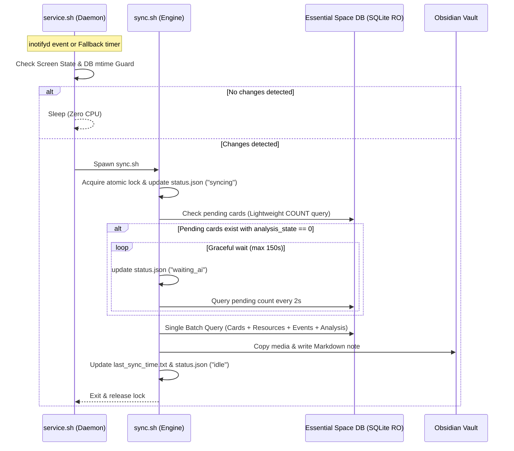

# Specification: Nothing Essential Sync Optimization & English-First Modernization

## 1. Overview & Goals
Optimize `nothing-essential-sync` (Magisk/KernelSU/APatch module) for:
1. **Power & Battery Efficiency**: Implement Doze-aware periodic fallback in `service.sh`, proper event debouncing, and lightweight mtime/state file early-exit guards.
2. **Sync Performance (Zero N+1 Calls)**: Consolidate card resource, event, and analysis queries into a single SQLite batch pass executed strictly **after** AI analysis completion is verified.
3. **English-First Standardization**: Transition all codebase comments, log output, UI strings, and defaults to English (with i18n support retained for generated notes).
4. **WebUI Optimization**: Incremental log streaming (`tail`), live status badge reporting (`idle`, `waiting_ai`, `syncing`), and reduced bridge overhead.

---

## 2. Component Architecture

### A. Daemon & Power Management (`service.sh`)
- **Display / Doze Awareness**:
  - Check screen state via `dumpsys window` or `dumpsys display`.
  - When screen is ON: maintain standard fallback interval (120s).
  - When screen is OFF / device is in Doze: relax fallback interval to 600s (10 min) to avoid CPU wakeups, relying primarily on `inotifyd`.
- **Early-Exit Guard**:
  - Before spawning `sync.sh` or acquiring heavyweight locks, check SQLite DB modification time (`mtime`) against `last_sync_time.txt`. If no DB file has changed since the recorded timestamp, exit immediately with 0 CPU overhead.
- **Debounce**:
  - `inotifyd` triggers pass through a short debounce window (2 seconds) to avoid bursting executions during active multi-row DB transactions.

### B. Core Synchronization Engine (`sync.sh`)
- **Two-Phase Architecture**:
  1. **Phase 1: Lightweight AI Wait Check**:
     - Check `count(*)` on pending cards: `(create_time > LAST_SYNC OR update_time > LAST_SYNC) AND ... AND (analysis_state = 0 OR summary IS NULL OR title IS NULL)`.
     - Poll interval: 2 seconds, max 150 seconds.
     - Emit progress logs every 6 seconds.
  2. **Phase 2: Consolidated Batch Extraction**:
     - Once AI analysis completes (or on timeout), query the complete card tree in a single consolidated SQL query:
       - Card fields (`card_id`, `create_time`, `update_time`, `title`, `summary`, `type`).
       - Attached resources (`card_resources`: text, transcription, image, audio).
       - Tasks/Todos (`card_events`: check status, content/title, timestamps).
       - AI analysis entries (`card_analysis`: raw_type, metadata JSON).
     - Render Markdown notes in a single streaming pass.
     - Eliminate 80-100 separate `sqlite3` process forks per sync run.
- **English-First Modernization**:
  - Code comments converted to English.
  - Core terminal logs output in English.
  - Markdown note section headers maintain locale awareness (`tr`, `en`, `de`, `fr`, `es`) defaulting to `en`.

### C. Live Status & WebUI Bridge (`webroot/`)
- **Status State Machine**:
  - `sync.sh` writes its current state to `/data/adb/essential-sync/status.json`:
    - `{"status": "idle" | "waiting_ai" | "syncing", "updated_at": <epoch>}`
- **WebUI Enhancements**:
  - Read `/data/adb/essential-sync/status.json` every 2-3s to render a live status badge (Idle / Processing / AI Analysis).
  - Log fetching switched to `tail -n 100` instead of reading entire unbounded `sync.log` files.
  - English-first UI strings with Turkish locale toggle if desired.

---

## 3. Data Flow & Execution Sequence

---

## 4. Error Handling & Edge Cases
- **Database Lock Isolation**: Read-only URI (`file:...mode=ro`) ensures zero risk of DB locks or app crashes.
- **Stale Locks**: Automatic cleanup of dead PIDs in `/data/local/tmp/essential_sync.lock`.
- **Media Preservation**: Safe copy of `.aac` -> `.m4a` conversion for HTML5 Obsidian audio compatibility.
- **Graceful Fallback**: If batch JSON extraction encounters malformed rows, fallback gracefully to standard text rendering.

---

## 5. Testing & Verification Plan
- Syntax check on all shell scripts (`sh -n sync.sh`, `sh -n service.sh`).
- Mock database execution tests with `bin/sqlite3` to verify single-pass batch output correctness.
- Verify log rotation, status file emission, and WebUI bridge response.
